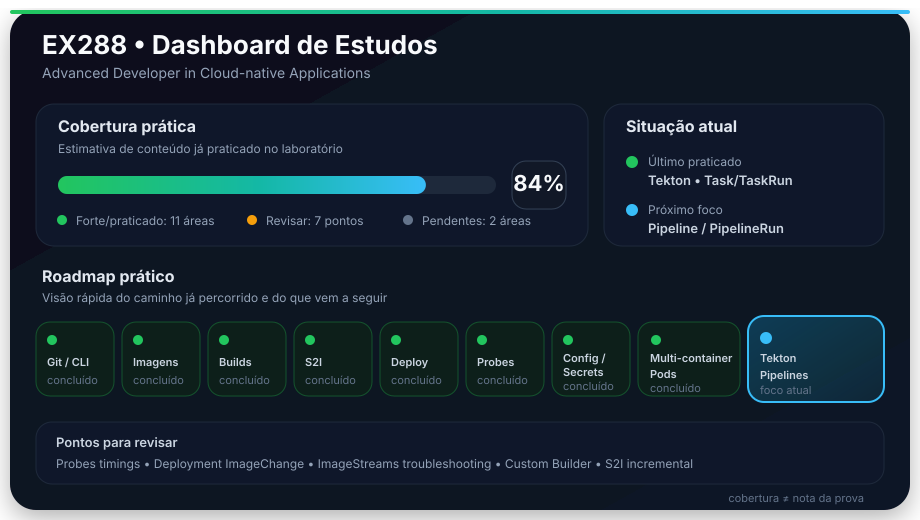

# EX288 Labs

Repositório pessoal de estudos para a certificação Red Hat EX288, com foco em prática hands-on no OpenShift.

O estudo será realizado progressivamente, construindo os recursos e aplicações conforme os tópicos forem sendo praticados.

## Status

Legenda:

- ⬜ não estudado
- 🟡 revisar
- ✅ consigo fazer sozinho

### Cobertura estimada do conteúdo

> Estimativa de cobertura prática do conteúdo da EX288 com base no que já foi estudado e executado em laboratório. Não representa peso oficial de questões nem probabilidade de aprovação.

<p align="center">
  
</p>

Leitura rápida:

```text
forte / praticado
→ Git e CLI oc; console web (Administrator e Developer)
→ Container Images, BuildConfig/Builds, ImageStreams e S2I
→ Deployments, rollouts, Services, Routes e probes
→ ConfigMaps, Secrets e multi-container Pods
→ Helm e OpenShift Templates (cold sims)
→ Tekton: Task/TaskRun, Pipeline/PipelineRun, params, runAfter, PVC e logs
→ Tekton: dois casos de troubleshooting executados (webhook e Step/workspace)
→ Operators: Subscription, CSV, CRD, CR, spec, status e conditions
→ Rede: selector, endpoints e HTTP 302 → HTTPS 200 validados

em andamento / precisa reforço
→ ImageChange trigger no Deployment e troubleshooting de ImageStreams
→ save-artifacts / incremental S2I e Custom Builder
→ Tekton: autonomia na correção de workspace entre Tasks
→ Operators: troubleshooting de CR com falha real
→ envFrom em manifest, timings de probes e multi-stage builds

praticado parcialmente / revisão adiada por prioridade
→ Kustomize (base/overlays/patches; sem cold sim ou troubleshooting)
→ troubleshooting básico de Pods (sem nova rodada de revisão)
```

A métrica acompanha **cobertura de conteúdo**, não domínio sob pressão de prova. A prontidão real será validada por exercícios sem ajuda e simulados integrados.

---

<!-- TOPICS_INDEX_START -->

# Material estudado

- [🧭 Mindmap navegável](mindmap/)
- [🧪 Índice de laboratórios](labs/)
- [01 — Fundamentos OpenShift e Git](topics/01-openshift-git/)
- [02 — Container Images](topics/02-container-images/)
- [03 — BuildConfig e Builds](topics/03-buildconfig-builds/)
- [04 — ImageStreams](topics/04-imagestreams/)
- [S2I — aplicação prática](s2i-python/)
- [S2I — troubleshooting prático](s2i-troubleshooting/)
- [06 — ConfigMaps e Secrets](topics/06-configmaps-secrets/)
- [07 — Health Monitoring / Probes](topics/07-health-monitoring/)
- [08 — Deployments e aplicações](topics/08-deployments-applications/)
- [09 — Troubleshooting](topics/09-troubleshooting/)
- [10 — OpenShift Templates — labs](labs/10-templates/)
- [11 — Helm — labs](labs/11-helm/)
- [12 — Kustomize — labs](labs/12-kustomize/)
- [13 — OpenShift Pipelines / Tekton](topics/13-tekton/) — [labs](labs/13-tekton/)

O `mindmap/` mostra como os objetos e fluxos se conectam. Os diretórios em `topics/` guardam conceitos, comandos, exercícios, validações e troubleshooting realizados durante os laboratórios.

<!-- TOPICS_INDEX_END -->

# Checklist EX288

## 1. Fundamentos OpenShift e Git

- ✅ Trabalhar com Projects / Namespaces
- ✅ Trabalhar com Pods
- ✅ Criar e gerenciar Deployments
- ✅ Entender ReplicaSets e revisões de rollout
- ✅ Criar e utilizar Services
- ✅ Criar e utilizar Routes
- ✅ Trabalhar com Git no fluxo de deployment
- ✅ Utilizar o console web do OpenShift (Deployment, Route/Service, PipelineRun e Operator)
- ✅ Utilizar a CLI `oc`

## 2. Container Images

- ✅ Criar Containerfile
- ✅ `FROM`
- ✅ `WORKDIR`
- ✅ `COPY`
- ✅ `RUN`
- ✅ `ENV`
- ✅ `EXPOSE`
- ✅ `ENTRYPOINT` e `CMD`
- ✅ Build de imagem
- ✅ Cache de layers
- 🟡 Multi-stage builds
- ✅ Execução com usuário não-root
- ✅ Compatibilidade com UID arbitrário
- ✅ Permissões de arquivos e diretórios
- ✅ Utilizar imagens no OpenShift

## 3. BuildConfig e Builds

- ✅ Criar BuildConfig
- ✅ Build a partir de Git
- ✅ Utilizar `contextDir`
- ✅ Docker / Containerfile build strategy
- ✅ Configurar output do build
- ✅ Iniciar build manualmente
- ✅ Acompanhar logs de build
- ✅ Cancelar builds
- ✅ Reiniciar builds com `oc cancel-build --restart`
- ✅ Reexecutar build com `oc start-build --from-build`
- ✅ Build triggers
- ✅ ImageChange trigger no BuildConfig
- ✅ Configurar histórico de builds
- ✅ Build Run Policy: `Serial`, `Parallel` e `SerialLatestOnly`
- ✅ Post-commit build hook
- 🟡 Custom builder
- ✅ Troubleshooting de builds

## 4. ImageStreams

- ✅ Entender ImageStreams
- ✅ Criar ImageStream
- ✅ Trabalhar com ImageStreamTag
- ✅ Entender tag x digest
- ✅ Publicar imagens no ImageStream
- ✅ Utilizar o registry interno do OpenShift
- ✅ Consumir ImageStream em aplicações
- ✅ Image change triggers
- 🟡 Troubleshooting de ImageStreams

## 5. Source-to-Image (S2I)

- ✅ Entender o fluxo S2I
- ✅ Identificar builder images
- ✅ Criar builds S2I
- ✅ Utilizar `sourceStrategy`
- ✅ Deployar aplicações construídas com S2I
- ✅ Entender `assemble` como etapa de build
- ✅ Entender `run` como etapa de runtime
- ✅ Customizar `.s2i/bin/assemble`
- ✅ Customizar `.s2i/bin/run`
- ✅ Comparar S2I e Containerfile/Docker strategy
- ✅ Troubleshooting de S2I
- ✅ Diagnosticar dependência inválida durante `assemble`
- ✅ Diagnosticar custom `assemble` com erro de permissão
- ✅ Diagnosticar custom `run` com Build `Complete` e Pod falhando
- 🟡 `save-artifacts` / incremental build
- 🟡 Automatizar rollout após build com ImageChange trigger no Deployment

## 6. ConfigMaps e Secrets

- ✅ Criar ConfigMap
- ✅ Criar ConfigMap a partir de arquivo
- ✅ Criar ConfigMap a partir de valores literais
- ✅ Injetar ConfigMap como variável de ambiente
- 🟡 Utilizar `envFrom` diretamente em manifest
- ✅ Montar ConfigMap como volume
- ✅ Criar Secret
- ✅ Injetar Secret como variável de ambiente
- ✅ Montar Secret como volume
- ✅ Atualizar configuração de aplicações

## 7. Health Monitoring

- ✅ Entender readiness probe
- ✅ Entender liveness probe
- ✅ Entender startup probe
- ✅ Criar HTTP probes
- ✅ Criar exec probes
- ✅ Criar TCP probes
- 🟡 Configurar delays, períodos e thresholds sem consulta
- ✅ Diagnosticar falhas de probes

## 8. Deployments e aplicações

- ✅ Criar aplicação single-container
- ✅ Criar aplicação multi-container
- ✅ Entender o padrão sidecar
- ✅ Compartilhar volume entre containers com `emptyDir`
- ✅ Utilizar `initContainers`
- ✅ Entender rede compartilhada entre containers do mesmo Pod
- ✅ Utilizar `localhost` entre containers do mesmo Pod
- ✅ Utilizar `oc logs -c` e `oc exec -c`
- ✅ Diagnosticar falha em `initContainer`
- ✅ Criar Deployment
- ✅ Atualizar aplicações
- ✅ Acompanhar rollouts
- 🟡 Configurar ImageChange trigger no Deployment com naturalidade
- ✅ Consultar histórico de rollout
- ✅ Inspecionar revisão específica
- ✅ Executar rollback
- ✅ Configurar estratégia `RollingUpdate`
- ✅ Configurar estratégia `Recreate`
- ✅ Entender `maxSurge`
- ✅ Entender `maxUnavailable`
- ✅ Entender `revisionHistoryLimit`
- ✅ Entender `progressDeadlineSeconds`
- ✅ Criar Service
- ✅ Criar Route
- ✅ Validar aplicação ponta a ponta

## 9. Troubleshooting

- ✅ `oc get`
- ✅ `oc describe`
- ✅ `oc logs`
- ✅ `oc logs --previous`
- ✅ `oc exec`
- ✅ Consultar Events
- ⬜ Diagnosticar `Pending`
- ✅ Diagnosticar `CrashLoopBackOff` / container reiniciando
- ✅ Diagnosticar `ImagePullBackOff`
- ✅ Diagnosticar falhas de Deployment / rollout
- 🟡 Diagnosticar Services (inspeção validada; sem falha provocada)
- 🟡 Diagnosticar Routes (HTTP/HTTPS validado; sem falha provocada)
- ✅ Conferir selector, endpoints e resposta HTTP/HTTPS ponta a ponta
- ✅ Diagnosticar Builds
- 🟡 Diagnosticar ImageStreams
- 🟡 Diagnosticar problemas de configuração

## 10. OpenShift Templates

- ✅ Entender Templates
- ✅ Criar Template
- ✅ Trabalhar com `parameters`
- ✅ Trabalhar com `objects`
- ✅ Processar Template
- ✅ Fornecer parâmetros
- ✅ Utilizar Templates existentes
- ✅ Troubleshooting de Templates

## 11. Helm

- ✅ Entender estrutura de um Chart
- ✅ `Chart.yaml`
- ✅ `values.yaml`
- ✅ Diretório `templates/`
- ✅ Criar Chart
- ✅ `helm template` e `helm lint`
- ✅ `helm install`
- ✅ `helm list` e `helm status`
- ✅ `helm get values` e `helm get manifest`
- ✅ `helm upgrade`
- ✅ `helm history`
- ✅ `helm rollback`
- ✅ `helm uninstall`
- ✅ Sobrescrever values com `-f` e `--set`
- ✅ Troubleshooting de Helm

## 12. Kustomize

- 🟡 Criar `kustomization.yaml`
- 🟡 Trabalhar com resources
- 🟡 Trabalhar com bases e overlays
- 🟡 Aplicar patches
- 🟡 Alterar imagens
- 🟡 Alterar réplicas
- 🟡 Trabalhar com labels
- 🟡 Renderizar com `oc kustomize`
- 🟡 Aplicar com `oc apply -k`
- ⬜ Troubleshooting de Kustomize

## 13. OpenShift Pipelines / Tekton

- ✅ Entender Task
- ✅ Criar Task
- ✅ Executar TaskRun
- ✅ Criar Pipeline
- ✅ Executar PipelineRun
- ✅ Utilizar parameters em Task/TaskRun e Pipeline/PipelineRun
- ✅ Utilizar workspaces em Task/TaskRun
- ✅ Utilizar workspaces compartilhados com PVC em Pipeline
- ✅ Conectar Tasks com `runAfter`
- ✅ Acompanhar execução
- ✅ Consultar logs por Step
- 🟡 Troubleshooting de pipelines (dois cenários praticados; correção de workspace exigiu orientação)
- ✅ Identificar falha de parâmetro no webhook e recriar PipelineRun
- ✅ Localizar Step com falha por PipelineRun → TaskRun → Pod → logs

## 14. Operators

- ✅ Identificar Operators disponíveis
- ✅ Inspecionar Subscription, CSV e versão instalada
- ✅ Identificar CRDs e recursos customizados com `oc api-resources`
- ✅ Consultar Custom Resources e `ownerReferences`
- ⬜ Criar recursos usando Operators existentes (não executado no cluster compartilhado)
- ✅ Consultar `spec`, `status` e `conditions`
- 🟡 Troubleshooting básico de recursos gerenciados por Operators (fluxo estudado; sem falha real)

## 15. Simulados

- ⬜ Simulado de builds
- ⬜ Simulado de ImageStreams
- ⬜ Simulado de S2I
- ⬜ Simulado de deployments
- ✅ Simulado de ConfigMaps e Secrets
- ✅ Simulado de multi-container Pods
- ⬜ Simulado de probes
- ✅ Simulado de Templates
- ✅ Simulado de Helm
- ⬜ Simulado de Kustomize
- ⬜ Simulado de Tekton
- ⬜ Simulado de troubleshooting
- ⬜ Simulado completo
- ⬜ Simulado completo sem ajuda

---

# Ambiente de laboratório

Cluster OpenShift disponível para prática.

Projeto utilizado nos estudos:

```text
monticelli-ex288
```

Repositório de estudos:

```text
ex288-labs
```

---

# Metodologia

Cada tópico será estudado por meio de tarefas práticas semelhantes às atividades esperadas em um ambiente OpenShift.

```text
conceito
   ↓
atividade prática
   ↓
validação
   ↓
troubleshooting
   ↓
repetição sem ajuda
```

Um item só recebe ✅ quando consigo executar a tarefa prática sem depender de uma solução pronta.

Se o assunto já foi praticado mas ainda precisa de reforço, recebe 🟡.

Ao concluir cada etapa:

```text
atualizar checklist
      ↓
atualizar README técnico do tópico
      ↓
atualizar mindmap
```

---

# Etapa atual

## Fase 14 — Operators e console web praticados

### Cold sim de OpenShift Templates

Arquivo:

```text
labs/10-templates/template-cold-sim.yaml
```

O exercício foi feito após alguns dias sem prática e cobriu:

```text
Template armazenável no cluster
→ parameters
→ required
→ generate: expression
→ Deployment + Service + Route
→ processamento local
→ processamento pelo nome
→ dry-run contra a API
→ criação dos recursos
→ validação de env
→ HTTP pela Route
```

Resultado:

```text
Templates                     ✅
retenção após pausa           ✅
fluxo oc apply / oc process   ✅
troubleshooting               ✅
```

**OpenShift Templates agora está marcado como ✅ consigo fazer sozinho.**

### Cold sim de Helm — concluído

Estrutura criada do zero:

```text
labs/11-helm/helm-cold-sim/
├── Chart.yaml
├── values.yaml
├── values-prod.yaml
└── templates/
    ├── deployment.yaml
    └── service.yaml
```

Fluxo executado:

```text
Chart do zero
→ helm lint
→ values.yaml
→ values-prod.yaml
→ --set
→ dry-run
→ install
→ list / status
→ get values / get manifest
→ upgrade
→ history
→ rollback
```

O exercício incluiu erro real durante a criação, diagnóstico, correção, nova validação e aplicação bem-sucedida.

Revisões comprovadas:

```text
revision 1 → Install complete
revision 2 → Upgrade complete
revision 3 → Rollback to 1
```

Também foi comprovado:

```text
Service :9090 respondendo
ENVIRONMENT=prod no Pod
upgrade 2 → 4 réplicas
rollback 4 → 2 réplicas
```

**Helm agora está marcado como ✅ consigo fazer sozinho.**

### Kustomize — mantido como 🟡

Já praticado:

```text
resources
base + overlays
replicas
images
labels
patches
oc kustomize
oc apply -k
```

O troubleshooting e o cold sim foram adiados deliberadamente para priorizar tópicos ainda não cobertos.

### Tekton — Pipelines, workspaces e troubleshooting praticados

O cluster expõe os recursos principais em `tekton.dev/v1`:

```text
Task
TaskRun
Pipeline
PipelineRun
```

O bloco inicial foi praticado do zero usando `oc`, sem depender do `tkn`.

Estrutura atual dos labs:

```text
labs/13-tekton/
├── 01-task-single/
├── 02-task-multi/
├── 03-task-params/
├── 04-task-workspace/
│   ├── 01-emptydir-basic/
│   └── 02-workspace-path/
├── 05-pipeline-basic/
│   ├── 01-two-tasks/
│   └── 02-three-tasks/
├── 06-pipeline-params/
│   ├── 01-single-task/
│   └── 02-two-tasks/
├── 07-pipeline-workspace/
│   ├── 01-basic-pvc/
│   ├── 02-two-tasks-pvc/
│   └── 03-three-tasks-pvc/
└── 08-troubleshooting/
    ├── 01-broken-pipeline/
    └── 02-failing-step/
```

Fluxo comprovado:

```text
Task
→ definição dos Steps

TaskRun
→ execução concreta

TaskRun
→ cria Pod

Steps
→ containers do Pod
→ executam em sequência
```

Conceitos praticados:

```text
1 Task + 1 Step                         ✅
1 Task + vários Steps                   ✅
TaskRun                                 ✅
Pod gerado pelo TaskRun                 ✅
Pipeline / PipelineRun                  ✅
runAfter                                ✅
múltiplos TaskRuns / múltiplos Pods     ✅
params em Task/TaskRun                  ✅
params em Pipeline/PipelineRun          ✅
repasse de params Pipeline → Task       ✅
workspace em Task/TaskRun               ✅
emptyDir entre Steps                    ✅
workspace compartilhado entre Tasks     ✅
PVC como backing do workspace           ✅
$(workspaces.<nome>.path)               ✅
logs por Step                           ✅
```

Substituições importantes:

```text
$(params.NAME)
→ substituição de parâmetro do Tekton

$(workspaces.NAME.path)
→ caminho do workspace resolvido pelo Tekton

$(cat arquivo)
→ command substitution do shell
```

Workspaces praticados:

```text
Task.spec.workspaces
→ declara necessidade

TaskRun.spec.workspaces
→ fornece storage concreto para uma TaskRun

Pipeline.spec.workspaces
→ declara workspace compartilhável pela Pipeline

Pipeline.spec.tasks[].workspaces
→ repassa o workspace da Pipeline para cada Task

PipelineRun.spec.workspaces
→ faz o binding concreto
→ emptyDir ou PVC
```

Comprovação entre Pods diferentes:

```text
writer TaskRun → Pod A
→ grava artifact.txt no PVC

deploy/reader TaskRun → Pod B
→ monta o mesmo PVC
→ lê artifact.txt
```

Regra consolidada:

```text
emptyDir
→ Steps do mesmo Pod

PVC
→ Tasks diferentes
→ TaskRuns diferentes
→ Pods diferentes
```

Comandos usados:

```bash
oc api-resources | grep -Ei 'task|pipeline'
oc get crd | grep -Ei 'tekton|pipeline'

oc explain task
oc explain task.spec
oc explain task.spec.steps
oc explain task.spec.params
oc explain task.spec.workspaces

oc explain taskrun
oc explain taskrun.spec
oc explain taskrun.spec.taskRef
oc explain taskrun.spec.params
oc explain taskrun.spec.workspaces

oc apply --dry-run=server -f <arquivo>
oc apply -f <arquivo>

oc get task
oc get taskrun
oc describe task <nome>
oc describe taskrun <nome>
oc get pods --sort-by=.metadata.creationTimestamp
oc logs <pod> -c step-<nome>
```

### Tekton — troubleshooting executado

```text
01-broken-pipeline
→ referência $(params.ENV) inexistente
→ webhook rejeitou a Pipeline
→ PipelineRun anterior terminou CouldntGetPipeline
→ correção do parâmetro + nova execução
→ Succeeded=True

02-failing-step
→ Step validate tentou ler artifact.txt inexistente
→ diagnóstico pelos logs do Pod
→ Task prepare criada antes de validate (runAfter)
→ emptyDir não compartilhou arquivos entre TaskRuns/Pods
→ PVC compartilhado + nova execução
→ Succeeded=True
```

Os dois cenários foram executados. O diagnóstico de logs e do webhook foi feito na prática; o ajuste de `emptyDir` para PVC no segundo caso precisou de orientação.

### Operators — discovery e saúde do OpenShift Pipelines

```text
Subscription: openshift-pipelines-operator-rh
→ channel latest; InstallPlan Automatic
→ CSV v1.24.2: Succeeded
→ TektonConfig/config: Ready=True; ComponentsReady=True
→ TektonPipeline/pipeline: Ready=True
→ TektonTrigger/trigger: Ready=True
→ ownerReferences: TektonTrigger controlado por TektonConfig
→ Pods gerenciados: Running/Ready
```

Inspecionados `oc get co`, `oc get csv -A`, `oc get subscriptions -A`, `oc api-resources`, `oc explain`, `oc describe` e `status.conditions`. `observedGeneration` não foi preenchido pela CR consultada; a ausência isolada desse campo não foi tratada como falha.

Não foi criada CR nova nem provocada falha em Operator do cluster compartilhado.

### Console web e networking — validação

```text
Deployment cold-sim → 2/2 réplicas disponíveis
Service cold-sim → selector app=cold-sim; 2 endpoints :8080
Route cold-sim → TLS edge + redirect
HTTP → 302 para HTTPS
HTTPS → 200 OK (servidor Python)
PipelineRun release-pipeline-run → Succeeded; prepare → build → deploy
Operator instalado → OpenShift Pipelines v1.24.2
```

Uma Route responder `302` não comprova resposta do backend; o `200` por HTTPS confirmou o caminho até a aplicação. A aplicação do laboratório servia um directory listing, o que não seria uma configuração apropriada para produção.

---

# Próxima atividade

## Revisão prática direcionada

```text
1. ImageStreams + ImageChange triggers no Deployment
2. S2I incremental / save-artifacts
3. Custom Builder / BuildConfig, se houver tempo
```

Kustomize e troubleshooting básico de Pods permanecem sem nova rodada de revisão. Os itens não praticados continuam com ⬜ ou 🟡 no checklist; cobertura estimada não significa domínio completo.
