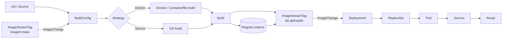
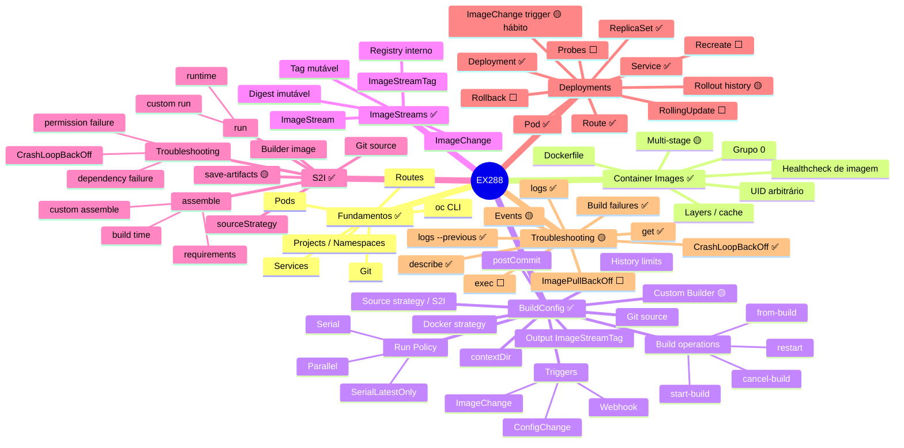
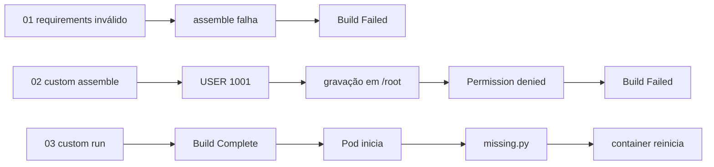
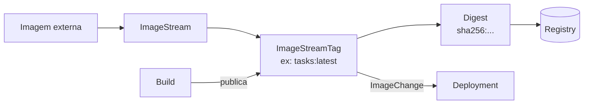
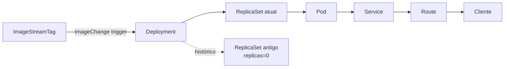
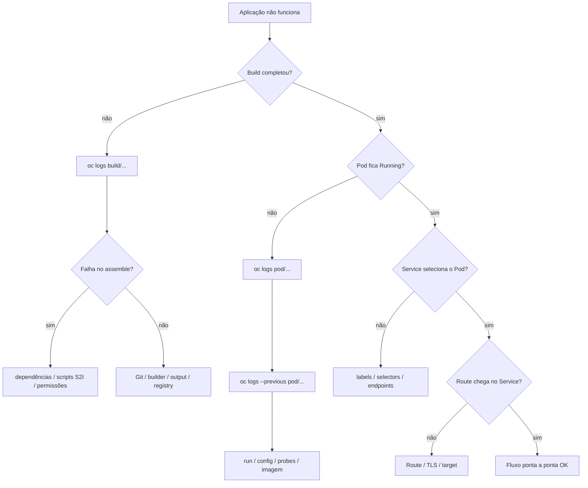
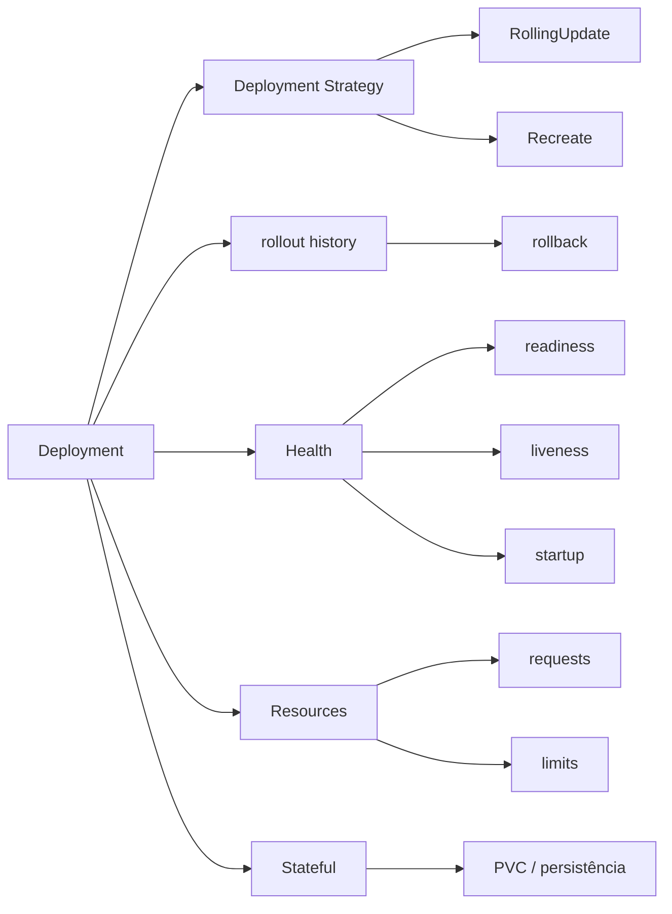

# EX288 — Mindmap navegável

[← Voltar para o README principal](../README.md)

Este mapa cresce junto com os estudos. O objetivo é mostrar **como os objetos do OpenShift se conectam** e fornecer atalhos para os capítulos técnicos e laboratórios do repositório.

## Navegação rápida

| Área | Status | Material |
|---|---|---|
| Fundamentos OpenShift e Git | ✅ | [Abrir](../topics/01-openshift-git/) |
| Container Images | ✅ / 🟡 multi-stage | [Abrir](../topics/02-container-images/) |
| BuildConfig e Builds | ✅ / 🟡 custom builder | [Abrir](../topics/03-buildconfig-builds/) |
| ImageStreams | ✅ / 🟡 troubleshooting | [Abrir](../topics/04-imagestreams/) |
| S2I | ✅ / 🟡 incremental + trigger habit | [Labs](../s2i-troubleshooting/) |
| Deployments e aplicações | ✅ base / 🟡 avançado | [Abrir](../topics/08-deployments-applications/) |
| Troubleshooting | 🟡 em evolução | [Abrir](../topics/09-troubleshooting/) |

## Visão geral do fluxo já praticado



### Fluxo automático já validado

```text
imagem-base muda de digest
        ↓
ImageChange do BuildConfig
        ↓
Build automático
        ↓
imagem da aplicação muda
        ↓
ImageChange do Deployment
        ↓
rollout automático
```

---

## Mapa dos domínios



---

## BuildConfig — mapa operacional

```mermaid
flowchart TD
    BC[BuildConfig]

    BC --> SRC[Source]
    SRC --> GIT[Git repository]
    SRC --> CTX[contextDir]

    BC --> STRAT[Strategy]
    STRAT --> DOCKER[Docker / Containerfile]
    STRAT --> SOURCE[Source / S2I]
    STRAT --> CUSTOM[Custom Strategy 🟡]

    SOURCE --> BUILDER[Builder Image]
    SOURCE --> ASSEMBLE[assemble]

    BC --> TRIG[Triggers]
    TRIG --> CONFIG[ConfigChange]
    TRIG --> IMAGE[ImageChange]
    TRIG --> WEBHOOK[GitHub / Generic webhook]

    BC --> OPS[Operações]
    OPS --> START[oc start-build]
    OPS --> CANCEL[oc cancel-build]
    OPS --> RESTART[oc cancel-build --restart]
    OPS --> FROMBUILD[oc start-build --from-build]

    BC --> POLICY[Run Policy]
    POLICY --> SERIAL[Serial]
    POLICY --> PARALLEL[Parallel]
    POLICY --> LATEST[SerialLatestOnly]

    BC --> HISTORY[History limits]
    HISTORY --> SUCCESS[successfulBuildsHistoryLimit]
    HISTORY --> FAILED[failedBuildsHistoryLimit]

    BC --> HOOK[postCommit]
```



### Comandos-chave

```bash
oc new-build --name <nome> -l app=<nome> --strategy=docker <git-url> --context-dir=<dir>

oc new-build \
  --name=<nome> \
  --strategy=source \
  --image-stream=<builder>:latest \
  --context-dir=<dir> \
  <git-url>

oc get bc
oc describe bc <nome>
oc set triggers bc/<nome>
oc start-build <nome> --follow
oc cancel-build <build>
oc cancel-build <build> --restart
oc start-build --from-build=<build>
oc set build-hook bc/<nome> --post-commit --script='<comando>'
oc edit bc/<nome>
```

---

## S2I — modelo mental

```mermaid
flowchart TD
    GIT[Git source] --> BC[BuildConfig<br/>sourceStrategy]
    BUILDER[Builder Image] --> BC

    BC --> BUILD[Build]

    BUILD --> SCRIPTSEL{Scripts S2I}

    SCRIPTSEL -->|source customizado| CUSTOM[.s2i/bin/*]
    SCRIPTSEL -->|fallback| DEFAULT[/usr/libexec/s2i/*]

    CUSTOM --> ASSEMBLE[assemble]
    DEFAULT --> ASSEMBLE

    ASSEMBLE --> OUT[ImageStreamTag]
    OUT --> DEPLOY[Deployment]

    DEPLOY --> POD[Pod]
    POD --> RUN[run]
```

### Regra central

```text
assemble
→ executa durante o Build
→ exit != 0 normalmente resulta em Build Failed

run
→ executa no container
→ pode existir Build Complete + Pod quebrado
```

### Como identificar qual `assemble` foi usado

```text
RUN /usr/libexec/s2i/assemble
→ script padrão da builder

RUN /tmp/scripts/assemble
→ script customizado vindo do source
```

### Labs de troubleshooting realizados



Comandos usados no diagnóstico:

```bash
oc get build -l app=<nome>
oc logs build/<build>
oc get pods
oc logs pod/<pod>
oc logs --previous pod/<pod>
```

---

## ImageStreams — modelo mental



```text
Tag
→ ponteiro mutável

Digest
→ referência imutável de uma imagem específica
```

Pegadinha já validada:

```text
oc tag A B

A e B apontam para o mesmo digest
→ não há mudança real de imagem
→ não é um bom teste de ImageChange
```

---

## Deployment — fluxo de runtime



Comandos-chave:

```bash
oc create deployment <nome> --image=<imagem>
oc expose deployment <nome> --port=8080 --target-port=8080
oc create route edge --service=<nome> --insecure-policy=Redirect

oc set triggers deployment/<nome>
oc set triggers deployment/<nome> --from-image=<imagestream>:latest -c <container>

oc rollout restart deployment/<nome>
oc rollout history deployment/<nome>
```

### Trigger x restart

```text
oc rollout restart
→ força novos Pods agora

oc set triggers ... --from-image=...
→ configura rollout automático para futuras mudanças da ImageStreamTag
```

Se a sintaxe não vier de memória:

```bash
oc set --help
oc set triggers --help
```

Observação já validada: ao omitir o nome em `oc create route edge --service=<service>`, a Route pode usar o nome do Service.

---

## Troubleshooting — fluxo de decisão



Casos reais já encontrados nos labs:

- `BuildConfigInstantiateFailed` enquanto uma imagem-base ainda não estava resolvida.
- webhook chegando como `system:anonymous` e falhando por RBAC.
- `ImageStreamTag` atualizado enquanto o Pod continuava com imagem antiga.
- `imagePullPolicy: Always` não provoca rollout sozinho.
- `contextDir` define contexto de build, não filtra eventos do webhook por caminho.
- `postCommit` com exit code diferente de zero faz o Build falhar.
- `requirements.txt` inválido causando falha no `assemble`.
- custom `assemble` tentando gravar em `/root` como `USER 1001`.
- custom `run` apontando para arquivo inexistente e causando reinício do container.
- `oc logs --previous` para recuperar logs da execução anterior de um container.

---

## Próximo ramo: Deployments avançados



Próximo objetivo: controlar o comportamento do Deployment durante atualizações e falhas, em vez de apenas criar a aplicação.

---

## Regra de manutenção

Ao terminar um bloco de estudo:

```text
README raiz
→ atualizar progresso

mindmap/README.md
→ atualizar relações e fluxos

topics/XX-*/README.md ou lab equivalente
→ registrar comandos, exemplos e troubleshooting
```
