# EX288 — Mindmap navegável

[← Voltar para o README principal](../README.md)

Este mapa cresce junto com os estudos. O objetivo é mostrar **como os objetos do OpenShift se conectam** e fornecer atalhos para os capítulos técnicos e laboratórios do repositório.

## Navegação rápida

| Área | Status | Material |
|---|---|---|
| Fundamentos OpenShift e Git / Console Web | ✅ | [Abrir](../topics/01-openshift-git/) |
| Container Images | ✅ / 🟡 multi-stage | [Abrir](../topics/02-container-images/) |
| BuildConfig e Builds | ✅ / 🟡 custom builder | [Abrir](../topics/03-buildconfig-builds/) |
| ImageStreams | ✅ / 🟡 troubleshooting | [Abrir](../topics/04-imagestreams/) |
| S2I | ✅ / 🟡 incremental + trigger habit | [Labs](../s2i-troubleshooting/) |
| Deployments e aplicações | ✅ rollout + multi-container | [Abrir](../topics/08-deployments-applications/) |
| Health Monitoring / Probes | ✅ core / 🟡 timings | [Abrir](../topics/07-health-monitoring/) |
| ConfigMaps e Secrets | ✅ core / 🟡 envFrom manifest | [Abrir](../topics/06-configmaps-secrets/) |
| Troubleshooting | 🟡 rede validada; falhas de Operators ainda não simuladas | [Abrir](../topics/09-troubleshooting/) |
| OpenShift Templates | ✅ cold sim concluído | [Labs](../labs/10-templates/) |
| Helm | ✅ cold sim concluído | [Labs](../labs/11-helm/) |
| Kustomize | 🟡 núcleo praticado / adiado | [Labs](../labs/12-kustomize/) |
| Tekton / Pipelines | ✅ núcleo + 2 casos de troubleshooting / 🟡 correção guiada de PVC | [Labs](../labs/13-tekton/) |
| Operators | ✅ discovery e inspeção / 🟡 falha real | [Checklist](../README.md#14-operators) |

---

## Visão geral do fluxo já praticado

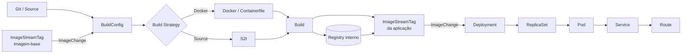

---

## Mapa dos domínios

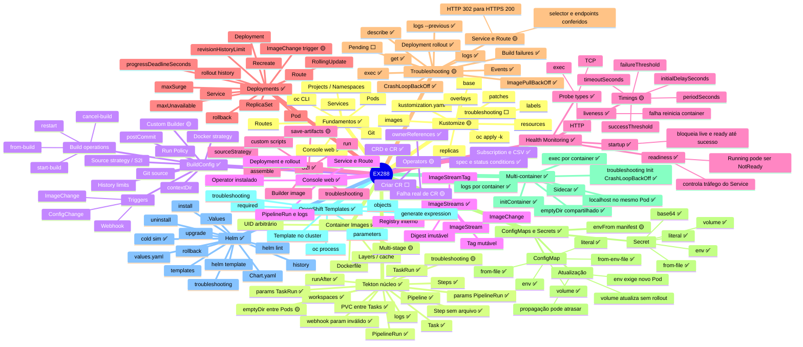

---

## S2I — modelo mental

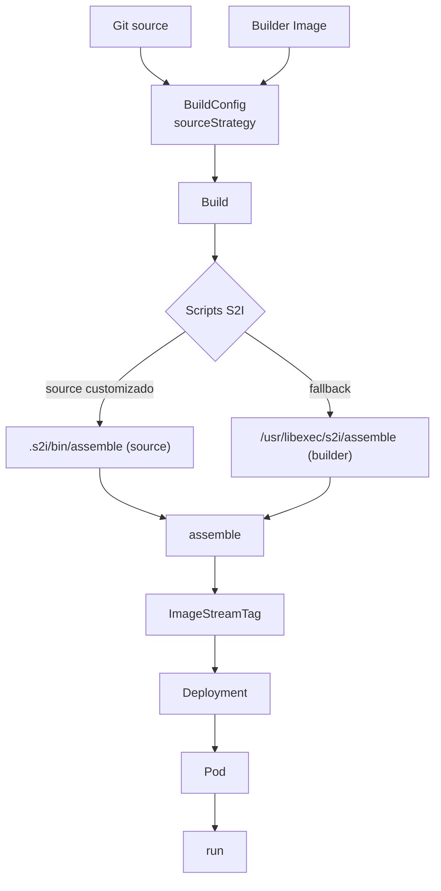

```text
assemble
→ build time

run
→ runtime
```

---

## Deployment — fluxo de runtime

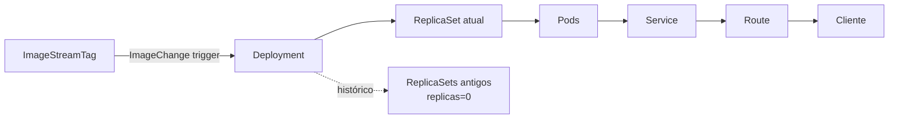

---

## Deployment — estratégia de rollout

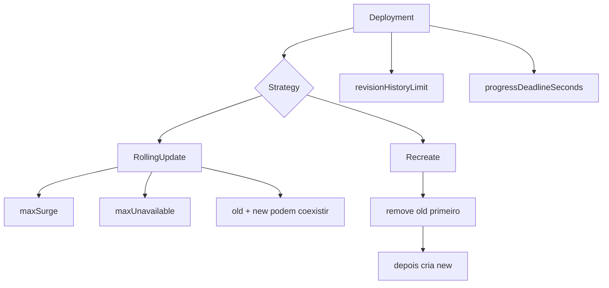

### RollingUpdate

```text
prioridade
→ disponibilidade

versão antiga + nova
→ podem coexistir durante rollout
```

Exemplo praticado com imagem quebrada:

```text
old Pod → Running
new Pod → ImagePullBackOff

resultado
→ old permaneceu disponível
```

### Recreate

```text
prioridade
→ evitar coexistência entre versões

old Pods
→ removidos primeiro

new Pods
→ criados depois
```

Exemplo praticado com imagem quebrada:

```text
old Pod → removido
new Pod → ImagePullBackOff

resultado
→ aplicação sem instância saudável
```

---

## `maxSurge` e `maxUnavailable`

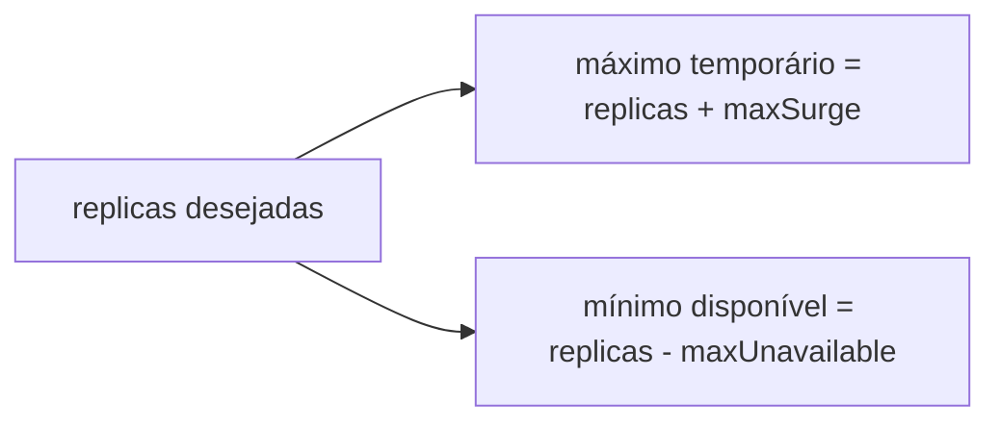

Modelo mental:

```text
maxSurge
→ quantos Pods extras posso criar?

maxUnavailable
→ quantos Pods posso perder temporariamente?
```

Exemplo estudado:

```yaml
replicas: 3
strategy:
  type: RollingUpdate
  rollingUpdate:
    maxSurge: 3
    maxUnavailable: 2
```

Resultado permitido:

```text
máximo temporário
3 + 3 = 6 Pods

mínimo disponível
3 - 2 = 1 Pod
```

`RollingUpdate` não significa obrigatoriamente "um Pod por vez". Com capacidade suficiente, vários Pods novos podem ser criados simultaneamente.

---

## `revisionHistoryLimit`

```text
revisionHistoryLimit: X
→ mantém até X ReplicaSets antigos
→ além do ReplicaSet atual
```

Exemplo:

```text
RS atual        replicas > 0
RS antigo #1   replicas = 0
RS antigo #2   replicas = 0
...
```

Esses ReplicaSets antigos sustentam o histórico e o rollback.

Comandos:

```bash
oc rollout history deployment/<nome>
oc rollout history deployment/<nome> --revision=<N>
```

---

## `progressDeadlineSeconds`

```text
rollout não progride
        ↓
deadline excedido
        ↓
ProgressDeadlineExceeded
```

Importante:

```text
progressDeadlineSeconds
→ detecta rollout sem progresso
→ NÃO faz rollback automático
```

---

## Rollback — fluxo validado

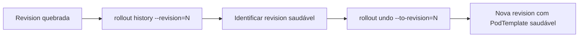

Comandos praticados:

```bash
oc rollout history deployment/s2i-broken-run

oc rollout history   deployment/s2i-broken-run   --revision=4

oc rollout undo   deployment/s2i-broken-run   --to-revision=3

oc rollout status deployment/s2i-broken-run
```

Pegadinha importante:

```text
rollback para revision 3
≠ Deployment passa a ser "revision 3"

o PodTemplate da revision 3
→ é reaplicado
→ surge uma nova revision
```

---

## Troubleshooting — Deployment

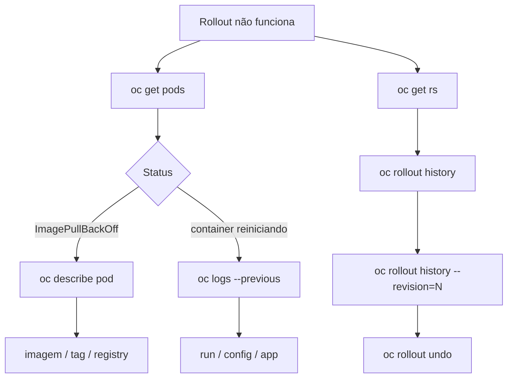

Comandos já usados na prática:

```bash
oc get pods -l app=<nome>
oc get pods -l app=<nome> -w
oc get rs -l app=<nome>
oc describe pod <pod>
oc rollout status deployment/<nome> --timeout=20s
oc rollout history deployment/<nome>
oc rollout history deployment/<nome> --revision=<N>
oc rollout undo deployment/<nome> --to-revision=<N>
oc exec deployment/<nome> -- <comando>
```

---

## Trigger x restart

```text
oc rollout restart
→ força novos Pods agora

oc set triggers ... --from-image=...
→ configura rollout automático quando a ImageStreamTag mudar
```

Para reconstruir sintaxe:

```bash
oc set --help
oc set triggers --help
```

---

## Health Monitoring / Probes — fluxo validado

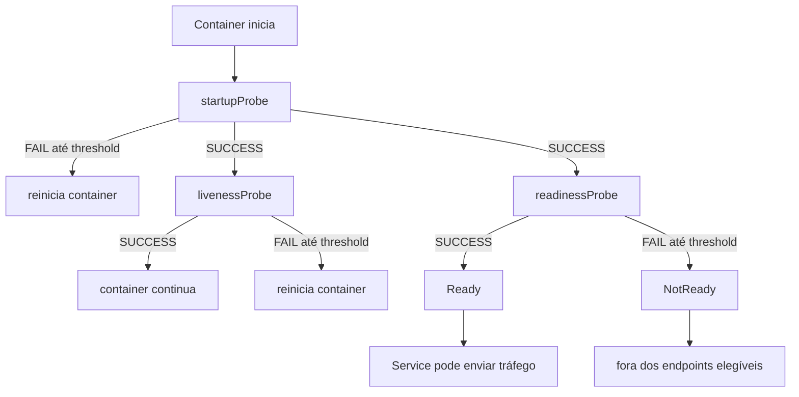

### Tipos de probe praticados

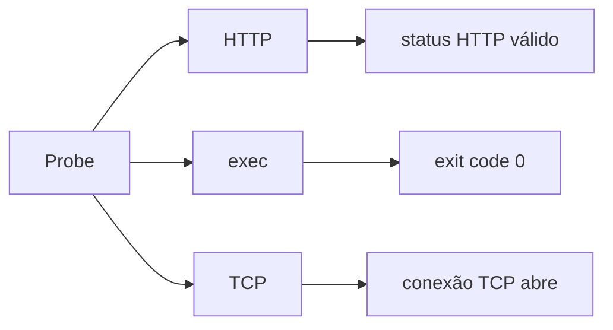

Modelo mental:

```text
startup
→ terminou de inicializar?

liveness
→ continua saudável?

readiness
→ já pode receber trabalho / tráfego?
```

### Timings e thresholds

```text
initialDelaySeconds
→ espera antes da primeira tentativa

periodSeconds
→ intervalo entre tentativas

timeoutSeconds
→ prazo de uma tentativa

failureThreshold
→ falhas consecutivas

successThreshold
→ sucessos consecutivos
```

Comando de inspeção que virou atalho:

```bash
oc get deploy probes-lab \
  -o jsonpath='{.spec.template.spec.containers[0].readinessProbe}' | jq
```

Troubleshooting usado:

```bash
oc events --for pod/<pod>
```

Lab TCP quebrado:

```text
readiness TCP → porta 9999
        ↓
connection refused
        ↓
novo Pod Running 0/1
        ↓
Pod antigo 1/1 preservado
        ↓
rollout sem progresso
        ↓
progressDeadlineSeconds excedido
```

---

## ConfigMaps e Secrets — fluxo validado

```mermaid
flowchart TD
    CFG[Configuração da aplicação] --> CM[ConfigMap]
    CFG --> SEC[Secret]

    CM --> CENV[env]
    CM --> CVOL[volume]
    SEC --> SENV[env]
    SEC --> SVOL[volume]

    CENV --> NEWPOD1[novo Pod para reler valor]
    SENV --> NEWPOD2[novo Pod para reler valor]

    CVOL --> UPDATE1[arquivo projetado atualiza sem rollout]
    SVOL --> UPDATE2[arquivo projetado atualiza sem rollout]

    UPDATE1 --> DELAY[atualização pode ter delay]
    UPDATE2 --> DELAY
```

Modelo mental:

```text
--from-file
→ nome do arquivo vira a key
→ conteúdo inteiro vira o value

--from-env-file
→ cada KEY=VALUE vira uma key separada

Secret.data
→ base64
→ encoding, não criptografia

env
→ alteração do ConfigMap / Secret não muda container já criado
→ novo Pod necessário

volume
→ atualização projetada pode aparecer sem rollout
→ pode existir atraso
→ subPath é exceção importante
```

Comandos praticados:

```bash
oc create cm app-config --from-literal=APP_MESSAGE=hello --from-literal=APP_MODE=study
oc create cm app-config-file --from-file app.properties
oc create cm app-config-env --from-env-file app.properties

oc set env deploy/config-lab --from=configmap/app-config-env
oc set volumes deploy/config-lab --add --type configmap \
  --configmap-name app-config-file --mount-path /etc/config

oc create secret generic app-secret \
  --from-literal=DB_USER=admin \
  --from-literal=DB_PASSWORD=s3cr3t

oc create secret generic app-secret-file --from-file=credentials.txt
oc set env deploy/config-lab --from=secret/app-secret
oc set volumes deploy/config-lab --add --type secret \
  --secret-name app-secret-file --mount-path /etc/secret

# remoção de volume criado incorretamente
oc set volumes deployment/config-lab --remove --name volume-svhks

oc rollout restart deploy/config-lab
```

Pegadinha praticada:

```text
--path
≠
--mount-path

volume criado errado
→ identificar o nome gerado
→ oc set volumes ... --remove --name <volume>
```

---

## Próximo ramo: Multi-container Pods

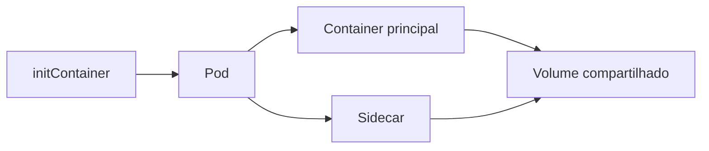

## Multi-container Pods — fluxo validado

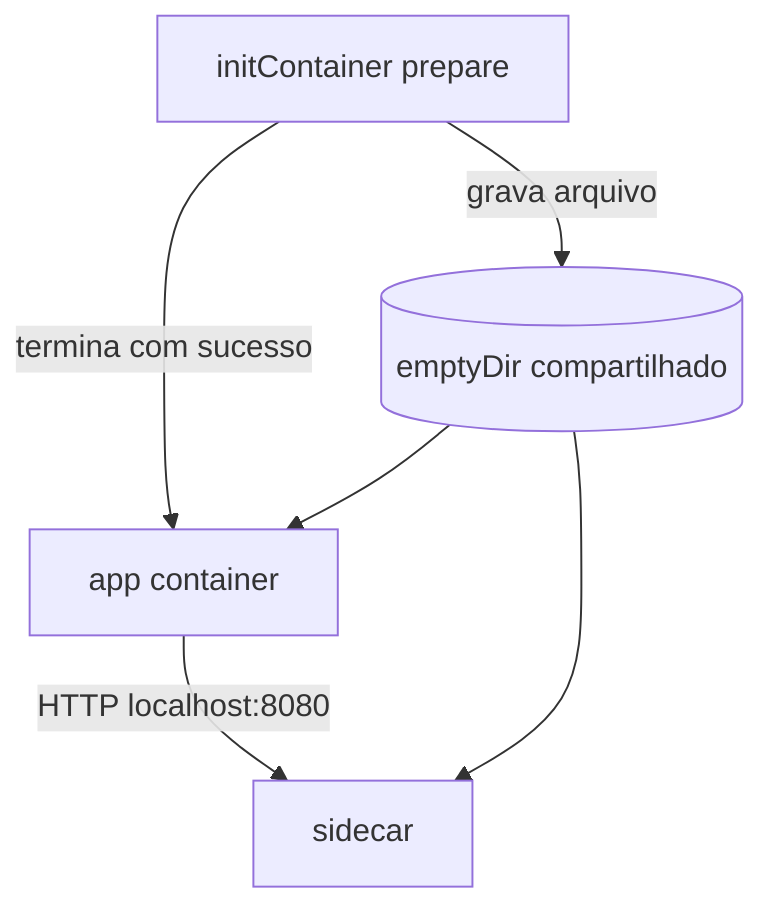

Modelo mental:

```text
sidecar
→ processo auxiliar de longa duração
→ acompanha a vida do Pod

initContainer
→ prepara algo antes
→ precisa terminar com sucesso

mesmo Pod
→ mesma rede / localhost
→ volumes só são compartilhados quando montados explicitamente
```

Troubleshooting consolidado:

```bash
oc get pod <pod>
oc describe pod <pod>
oc logs <pod> -c <container>
oc exec <pod> -c <container> -- <comando>
oc events --for pod/<pod>
```

Mini-simulado concluído:

```text
initContainer → cria index.html
app → serve o arquivo em :8080
sidecar → curl -s localhost:8080/index.html
broken → initContainer sem volumeMount
resultado → Init:CrashLoopBackOff
```

---

## Helm — modelo mental

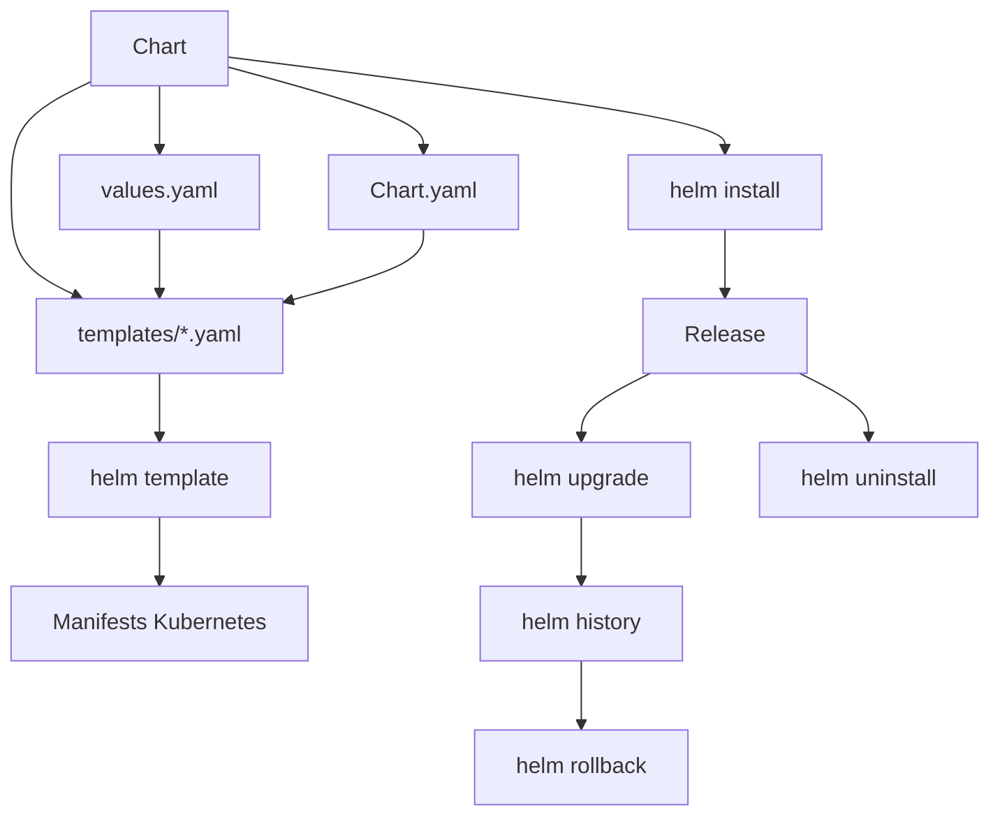

Modelo mental:

```text
YAML Kubernetes correto
→ identificar o que deve ser configurável
→ mover defaults para values.yaml
→ referenciar com {{ .Values... }}
→ helm lint
→ helm template
→ validar na API
```

Troubleshooting:

```text
helm lint / template falha
→ problema no template Helm

render funciona + API rejeita
→ problema no manifest Kubernetes

API aceita + app falha
→ troubleshooting normal com oc
```

### Cold sim de Helm

```text
Chart do zero
→ erro real
→ diagnóstico
→ correção
→ lint / dry-run
→ install
→ upgrade
→ history
→ rollback
```

Resultado:

```text
revision 1 → install
revision 2 → upgrade
revision 3 → rollback to 1

Helm → ✅ consigo fazer sozinho
```

---

## Kustomize — modelo mental

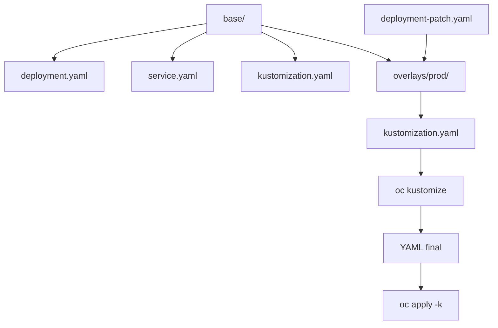

```text
base
→ manifests comuns

overlay
→ diferenças do ambiente

resources
→ inclui base/manifests

replicas
→ altera quantidade

images
→ troca imagem/tag

labels
→ adiciona labels

patches
→ altera campos específicos
```

Regra prática:

```text
kustomization.yaml
→ sintaxe própria do Kustomize

patch.yaml
→ estrutura de recurso Kubernetes
→ oc explain continua útil
```

---

## Tekton — fluxo praticado

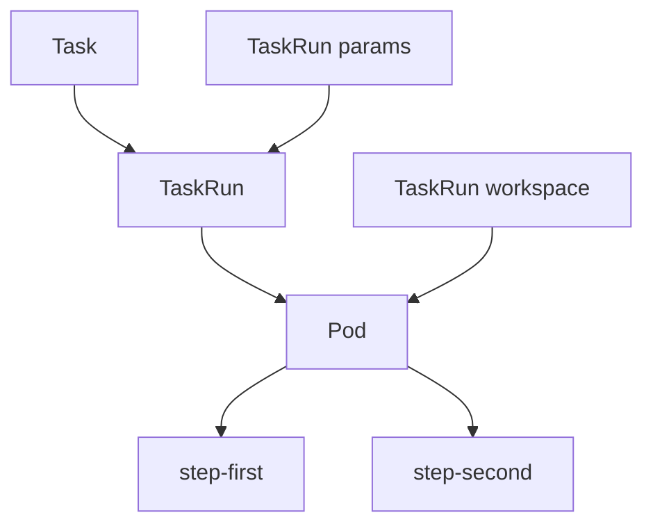

Modelo mental atual:

```text
Task
→ receita

TaskRun
→ execução concreta

TaskRun
→ cria 1 Pod

Steps
→ containers no mesmo Pod
→ execução sequencial
```

### Params

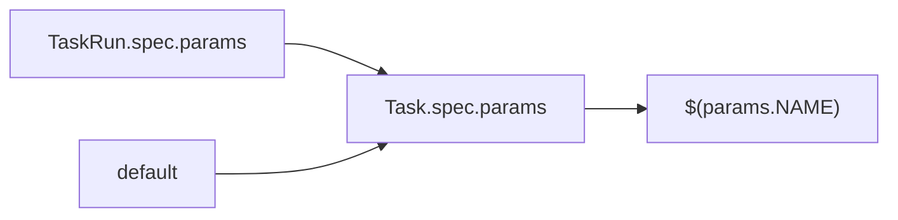

```text
Task.spec.params
→ declara

TaskRun.spec.params
→ fornece / sobrescreve

default
→ usado quando TaskRun omite o valor
```

### Workspaces

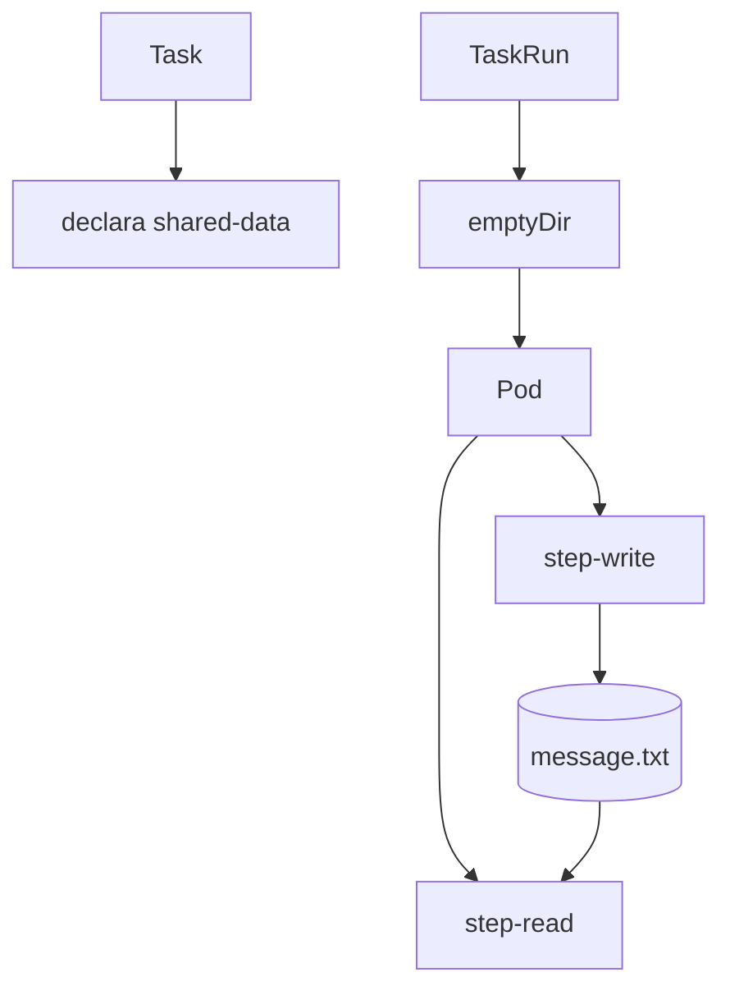

```text
$(workspaces.shared-data.path)
→ caminho real do workspace

emptyDir
→ compartilha arquivos entre Steps do mesmo Pod

Tasks diferentes
→ TaskRuns diferentes
→ Pods diferentes
→ precisam de storage compartilhado, como PVC
```

### Pipeline / PipelineRun

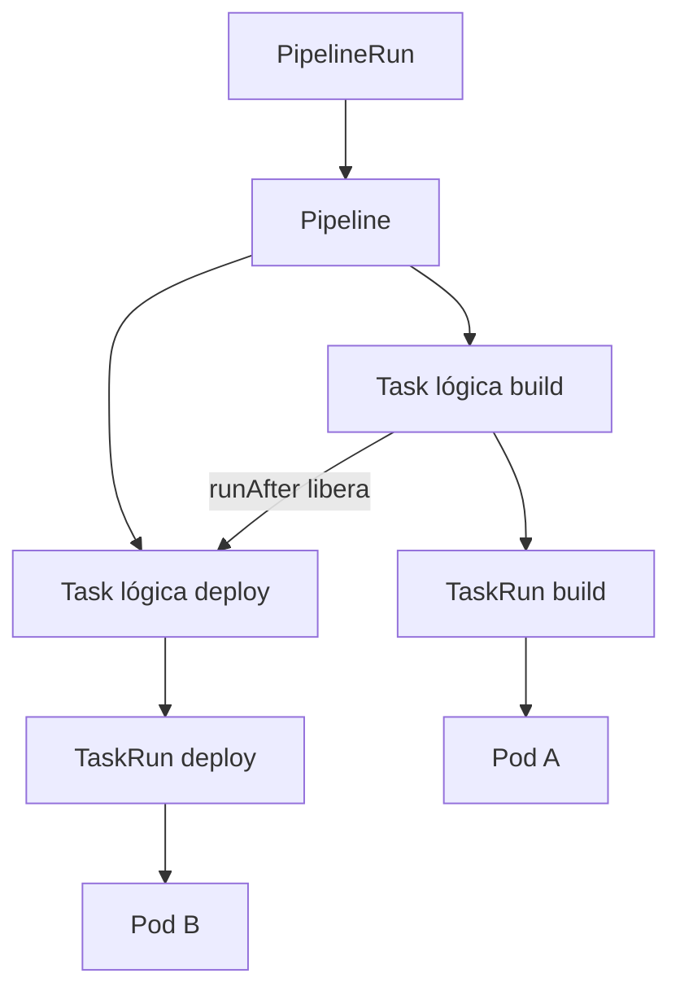

### Params em Pipeline

```mermaid
flowchart LR
    PRP[PipelineRun.spec.params] --> PP[Pipeline.spec.params]
    PP --> MAP[Pipeline.spec.tasks[].params]
    MAP --> TP[Task.spec.params]
    TP --> STEP["$(params.NAME)"]
```

### Workspace com PVC entre Tasks

```mermaid
flowchart TD
    PVC[(PVC)] --> PRW[PipelineRun workspace]
    PRW --> PW[Pipeline workspace]
    PW --> BW[build workspace]
    PW --> DW[deploy workspace]
    BW --> PA[Pod A grava artifact.txt]
    DW --> PB[Pod B lê artifact.txt]
```

```text
params
→ valores

workspaces
→ filesystem/storage

PipelineRun
→ fornece os valores e bindings concretos
```

---
## Tekton — troubleshooting praticado

```mermaid
flowchart TD
    PR[PipelineRun falhou] --> START{TaskRun criada?}
    START -->|Não| VALID[Verificar Pipeline, params e webhook]
    VALID --> FIX1[Corrigir variável inexistente]
    FIX1 --> NEW1[Nova PipelineRun]
    START -->|Sim| TR[TaskRun]
    TR --> POD[Pod]
    POD --> STEP[Step]
    STEP --> LOG[oc logs -c step-nome]
    LOG --> FILE[artifact.txt não encontrado]
    FILE --> WS{Tasks em Pods diferentes?}
    WS -->|Sim| PVC[Workspace com PVC compartilhado]
    PVC --> NEW2[Nova PipelineRun]
```

Laboratórios executados:

```text
08-troubleshooting/01-broken-pipeline
→ Pipeline rejeitada pelo webhook por $(params.ENV) inexistente
→ PipelineRun ficou CouldntGetPipeline
→ variável corrigida, execução recriada e Succeeded=True

08-troubleshooting/02-failing-step
→ Step validate falhou ao ler artifact.txt inexistente
→ logs identificaram o arquivo ausente
→ prepare executada antes de validate com runAfter
→ emptyDir isolado por Pod; corrigido com PVC (com orientação)
→ PipelineRun Succeeded=True
```

### Regra de storage consolidada

```text
Steps da mesma TaskRun / Pod
→ emptyDir pode compartilhar arquivos

Tasks diferentes / TaskRuns e Pods diferentes
→ emptyDir não é compartilhado entre os Pods
→ usar storage acessível aos dois, como PVC

runAfter
→ define ordem, não transfere arquivos
```

---

## Operators — descoberta e reconciliação

```mermaid
flowchart TD
    SUB[Subscription] --> CSV[CSV / versão do Operator]
    CSV --> CRD[CRD / novo tipo de recurso]
    CRD --> CR[Custom Resource]
    CR --> SPEC[spec / estado desejado]
    OP[Operator / controlador] --> STATUS[status.conditions / observado]
    SPEC --> OP
    OP --> CHILD[Recursos gerenciados]
    CHILD --> STATUS
```

Inspeção executada no cluster:

```text
Subscription openshift-pipelines-operator-rh
→ channel latest / aprovação Automatic

CSV openshift-pipelines-operator-rh.v1.24.2
→ Succeeded

TektonConfig/config
→ Ready=True / ComponentsReady=True
→ status.observedGeneration não preenchido

TektonPipeline/pipeline
→ Ready=True

TektonTrigger/trigger
→ Ready=True
→ ownerReferences aponta para TektonConfig/config
```

```text
CSV Succeeded
→ instalação do Operator OK
≠
CR necessariamente saudável

CR Ready=False
→ oc describe da CR
→ conditions / reason / message
→ CRs filhas, Pods, logs e events
```

Não foi criada uma CR nova nem simulada uma falha de Operator no cluster compartilhado.

---

## Console web e rede — fluxo validado

```mermaid
flowchart LR
    CLIENT[Cliente] -->|HTTP| ROUTE[Route TLS edge]
    ROUTE -->|302 Redirect| HTTPS[HTTPS]
    HTTPS -->|encaminha| SVC[Service cold-sim]
    SVC -->|selector app=cold-sim| PODS[2 Pods :8080]
    PODS -->|resposta| OK[200 OK]
```

```text
Console web
→ Deployment cold-sim: 2/2 réplicas disponíveis
→ Service e Route: host, porta e destino
→ PipelineRun release-pipeline-run: prepare → build → deploy
→ CSV do OpenShift Pipelines: v1.24.2

CLI / curl
→ Service com dois endpoints e selector compatível
→ HTTP 302 esperado por insecureEdgeTerminationPolicy: Redirect
→ HTTPS 200 confirma resposta do servidor Python
```

Não confundir `302` do router com `200` da aplicação; Pods Ready e endpoints também não garantem, isoladamente, uma resposta HTTP válida.

---

## Revisão prática direcionada

```text
ImageStreams + ImageChange triggers no Deployment
→ S2I save-artifacts / incremental
→ Custom Builder / BuildConfig (se houver tempo)

Kustomize e troubleshooting básico de Pods
→ revisão adicional não priorizada
```

---

## Regra de manutenção

Ao terminar um bloco de estudo:

```text
README raiz
→ atualizar progresso

mindmap/README.md
→ atualizar relações e fluxos

topics/XX-*/README.md
→ registrar comandos, exemplos e troubleshooting
```
